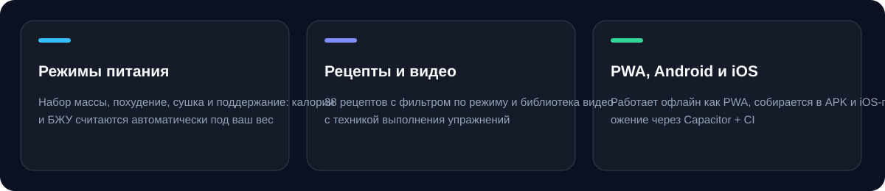

<p align="center">
  
</p>

<p align="center">
   
  <a href="https://ihappyz0.github.io/123321/"></a>
  <a href="https://github.com/ihappyz0/123321/archive/refs/heads/main.zip"></a>
</p>

# 123321

## О проекте

**GymMind** — это фитнес-приложение, которое помогает выстроить питание под вашу цель. Один и тот же код работает в браузере, на Android и на iOS благодаря упаковке через Capacitor. Приложение считает дневную норму калорий, подбирает рецепты под выбранный режим и подсказывает, сколько ещё нужно добрать после еды.

## Возможности

- 🍚 **Четыре режима питания** — набор массы, похудение, сушка и поддержание формы
- 🔥 **Автоматический расчёт калорий и БЖУ** под каждый режим
- 🥣 **38 рецептов** с ингредиентами, КБЖУ и пошаговым приготовлением
- 📊 **Учёт добора калорий** после приёма пищи
- 📱 **Нативные оболочки** для Android и iOS через Capacitor
- 🌐 **PWA-режим** — установка на экран «Домой» без сторов
- 📴 **Офлайн-работа** благодаря service worker и кэшу оболочки
- 🤖 **Автосборка APK** через GitHub Actions при каждом пуше

## Как установить и пользоваться

1. **Клонируйте репозиторий и установите зависимости:**
   ```bash
   npm install
   npm run web
   ```

2. **Запустите в браузере** — откройте `index.html` или поднимите локальный сервер.

3. **Выберите режим питания** в разделе «Питание»: набор массы, похудение, сушка или поддержание.

4. **Получите дневную норму** калорий и БЖУ, рассчитанную под вашу цель.

5. **Подбирайте рецепты** из библиотеки — каждый блюдо содержит ингредиенты, КБЖУ и инструкцию.

6. **Соберите мобильное приложение** (по желанию):
   ```bash
   npm run add:android
   npm run sync
   npm run android
   ```
   Подробная инструкция для Android и iOS — в файле [MOBILE.md](MOBILE.md).

7. **Установите как PWA** — в Chrome через меню «Установить приложение», в Safari через «На экран Домой».

<p align="center">
  
</p>

## 📦 Быстрое скачивание

- **Прямой архив:** [Скачать последнюю версию (.zip)](https://github.com/ihappyz0/123321/archive/refs/heads/main.zip)
- **Git:** `git clone https://github.com/ihappyz0/123321.git`

## 📁 Структура проекта

- `.gitignore`
- `LICENSE`
- `MOBILE.md`
- `README.md`
- `capacitor.config.json`
- `diet-modes.js`
- `index.html`
- `manifest.webmanifest`
- `package.json`
- `sw.js`
- `tmp_dm_grep.txt`
- `tmp_nr_grep.txt`
- `video-library.js`
- `.github/workflows/android.yml`
- `resources/icon.svg`
- `resources/splash.svg`
- `scripts/build-web.mjs`

## 📄 Лицензия

Проект распространяется под лицензией MIT (`LICENSE`).
