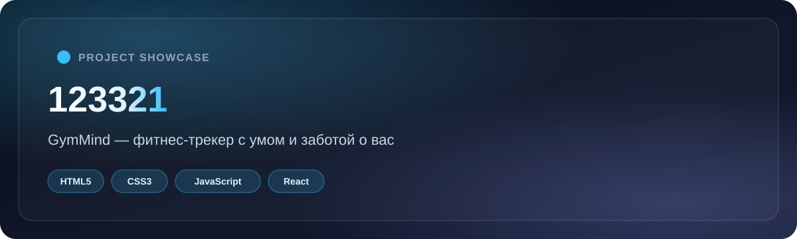

<p align="center">
  
</p>

<p align="center">
   
  <a href="https://ihappyz0.github.io/123321/"></a>
  <a href="https://github.com/ihappyz0/123321/archive/refs/heads/main.zip"></a>
</p>

# 123321

## О проекте

**GymMind** — это прогрессивное веб-приложение (PWA) для тренировок и питания, которое упаковывается в нативные приложения для Android и iOS с помощью Capacitor. Один и тот же код работает в браузере, на телефоне и в сторах.

## Возможности

- 🏋️ Учёт тренировок и прогресса
- 🍽️ Режимы питания: масса, сушка, похудение, поддержание
- 🔄 Синхронизация выбранного режима между разделами «Обзор» и «Питание»
- 📱 Нативные сборки для Android (APK/AAB) и iOS
- 🌐 PWA с офлайн-режимом и установкой на домашний экран
- ⚙️ Автоматическая сборка APK через GitHub Actions

## Как установить и пользоваться

1. **Клонируйте репозиторий и установите зависимости:**
   ```bash
   npm install
   npm run web
   ```

2. **Запустите в браузере:** откройте `index.html` или запустите локальный сервер.

3. **Сборка для Android:**
   ```bash
   npm run add:android
   npm run sync
   npm run android
   ```
   Или соберите APK без Android Studio: `npm run android:apk`.

4. **Сборка для iOS (только macOS):**
   ```bash
   npm run add:ios
   npm run sync
   cd ios/App && pod install && cd ../..
   npm run ios
   ```

5. **Установка как PWA:** на Android в Chrome выберите «Установить приложение», на iOS в Safari — «На экран Домой».

6. **Автоматическая сборка:** при пуше в `main` GitHub Actions соберёт debug APK — скачайте артефакт `gymmind-debug-apk` из раздела Actions.

<p align="center">
  
</p>

## 📦 Быстрое скачивание

- **Прямой архив:** [Скачать последнюю версию (.zip)](https://github.com/ihappyz0/123321/archive/refs/heads/main.zip)
- **Git:** `git clone https://github.com/ihappyz0/123321.git`

## 📁 Структура проекта

- `.gitignore`
- `LICENSE`
- `MOBILE.md`
- `README.md`
- `capacitor.config.json`
- `diet-mode-sync.js`
- `diet-modes.js`
- `index.html`
- `manifest.webmanifest`
- `package.json`
- `sw.js`
- `tmp_dm_grep.txt`
- `tmp_nr_grep.txt`
- `video-library.js`
- `.github/workflows/android.yml`
- `resources/icon.svg`
- `resources/splash.svg`
- `scripts/build-web.mjs`

## 📄 Лицензия

Проект распространяется под лицензией MIT (`LICENSE`).
